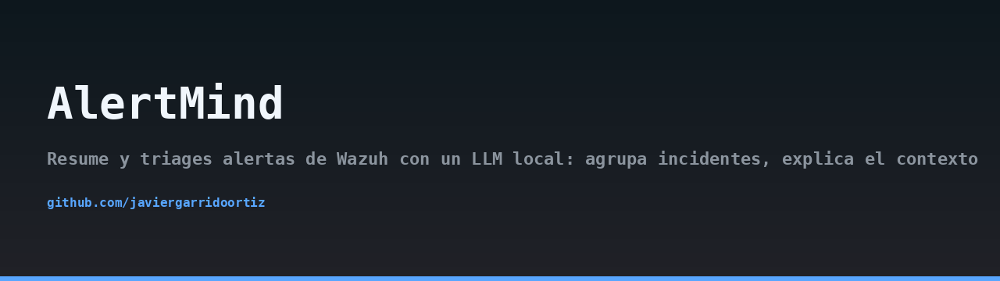
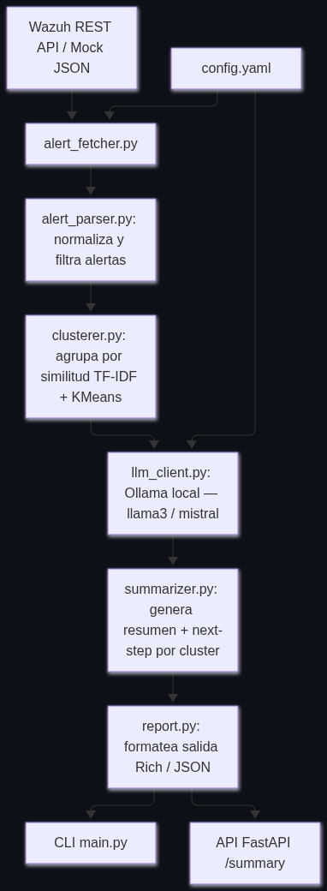
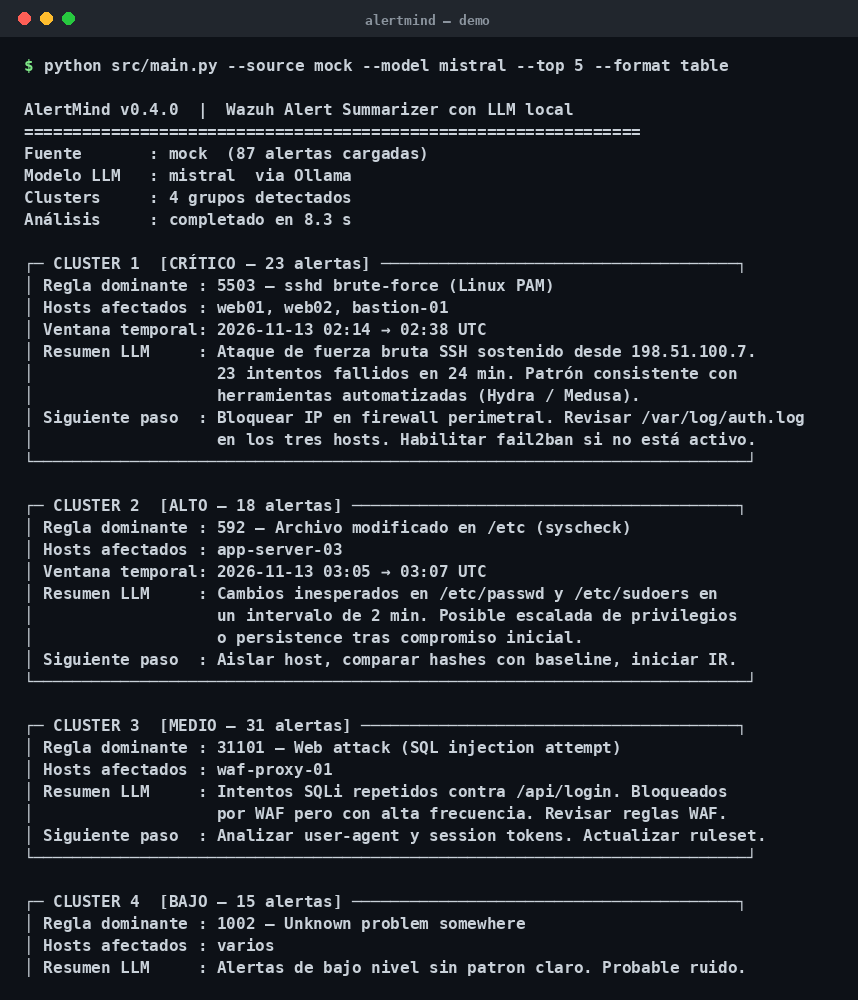

## Architecture



## Demo



> 🇪🇸 Read this in [Spanish](README.md).

# AlertMind

AlertMind resumes and triages Wazuh alerts using a local LLM. It groups related incidents, explains the context behind each cluster, and suggests the next step for the analyst. No alert data ever leaves the perimeter: the model runs entirely on Ollama on your own machine.

## Why

A SOC analyst facing hundreds of Wazuh alerts per shift spends most of the time reading noise. AlertMind reduces that noise by clustering similar alerts, summarizing what is actually happening, and proposing a concrete next action. Everything runs locally so sensitive telemetry stays inside your network.

## Features

- Fetches alerts from the Wazuh REST API using JWT authentication, or from a bundled mock file for offline testing.
- Normalizes raw alerts into a typed `AlertEvent` structure.
- Clusters alerts by description using TF-IDF plus KMeans, with automatic cluster count selection via the elbow method (bounded between 2 and 8).
- Sends a structured Spanish prompt to a local Ollama model with a SOC analyst system prompt.
- Parses the model response into a validated `SummaryResult` (Pydantic v2).
- Renders output as a colored Rich table in the CLI or as JSON from the FastAPI endpoint.
- Centralized configuration through `config.yaml`.

## Architecture

The flow is linear and each module has a single responsibility:

1. `alert_fetcher.py` pulls alerts from Wazuh or from `data/mock_alerts.json`.
2. `alert_parser.py` normalizes them into `AlertEvent` objects.
3. `clusterer.py` vectorizes descriptions and groups them into clusters.
4. `llm_client.py` builds the prompt and queries Ollama.
5. `summarizer.py` parses the response into `SummaryResult`.
6. `report.py` renders the result for the CLI or the API.

`main.py` orchestrates the pipeline from the command line. `api.py` exposes the same pipeline over HTTP.

## Requirements

- Python 3.11
- A running Ollama instance with a model pulled (for example `llama3.1`)
- Access to a Wazuh manager REST API (optional if using the mock source)

## Installation

```bash
git clone https://github.com/javiergarrido/alertmind.git
cd alertmind
python -m venv .venv
source .venv/bin/activate
pip install -r requirements.txt
```

Pull the model you intend to use:

```bash
ollama pull llama3.1
```

## Configuration

Copy the example configuration and adjust it:

```bash
cp config.example.yaml config.yaml
```

Key fields in `config.yaml`:

- `wazuh.url`: base URL of the Wazuh manager API.
- `wazuh.user` and `wazuh.password`: credentials used to obtain the JWT. Read from environment variables is recommended; see below.
- `ollama.model`: name of the local model.
- `ollama.url`: Ollama endpoint, defaults to `http://localhost:11434/api/generate`.
- `alerts.max_alerts`: upper bound on how many alerts are fetched per run.
- `alerts.min_level`: minimum Wazuh rule level to include.
- `alerts.lookback_minutes`: time window to query.

Credentials should not be written directly into the file. Use environment variables and reference them from the config, or export them before running:

```bash
export WAZUH_USER="analyst"
export WAZUH_PASSWORD="change-me"
```

## Usage

Run against the mock dataset to see the pipeline end to end:

```bash
python src/main.py --source mock
```

Run against a live Wazuh instance:

```bash
python src/main.py --source wazuh --lookback 60
```

Start the API:

```bash
uvicorn src.api:app --host 127.0.0.1 --port 8000
```

Then query it:

```bash
curl http://127.0.0.1:8000/summary
```

## Output example

The CLI prints one Rich table per cluster with the severity, a short summary, the MITRE tactics involved, and a suggested next step. The API returns the same information as a JSON array of `SummaryResult` objects.

## Testing

```bash
pytest -q
```

Tests cover alert parsing, clustering behavior, and summary parsing. They do not require a running Ollama instance.

## Ethical notice

AlertMind is a decision-support tool. It summarizes and suggests, but it does not replace the analyst. Always validate the model output against the raw alerts before acting on it. The local-only design is intentional: it keeps telemetry inside your perimeter, but it does not make the model infallible. Treat every suggestion as a hypothesis to confirm.

## License

MIT. See `LICENSE` for details.

## Author

Javier Garrido Ortiz.
