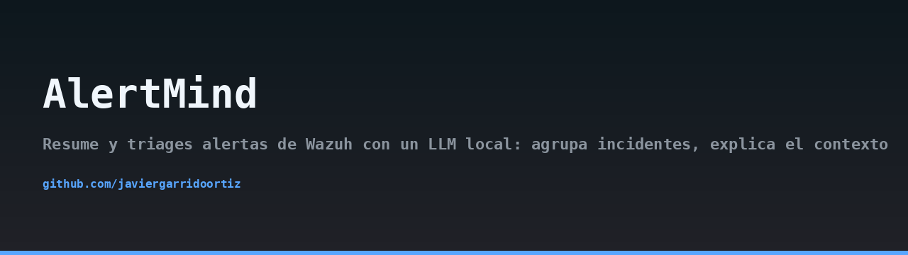
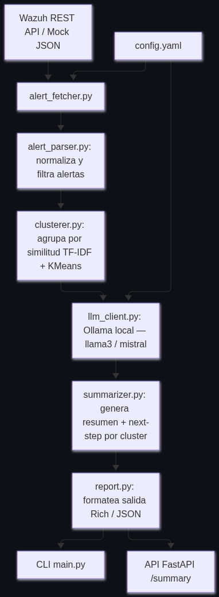
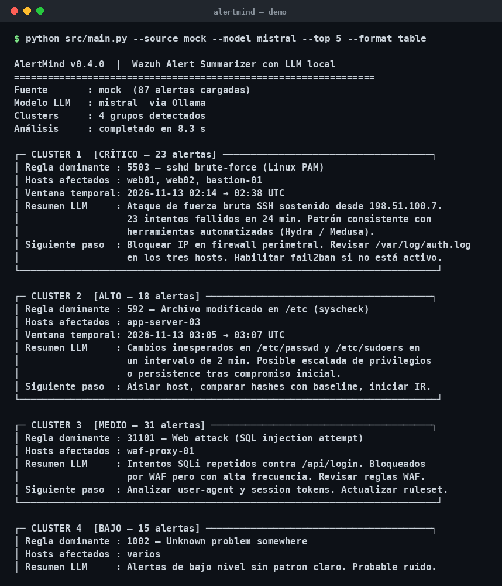
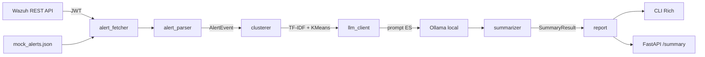

## Arquitectura



## Demo



> 🇬🇧 Read this in [English](README.en.md).

# AlertMind

[](https://www.python.org/downloads/)
[](LICENSE)
[](https://ollama.com)
[](https://wazuh.com)

AlertMind es una herramienta de apoyo al analista de SOC que resume y triagea alertas de Wazuh utilizando un modelo LLM ejecutado íntegramente en local. Agrupa incidentes relacionados, explica el contexto de cada cluster y sugiere el próximo paso operativo, sin que ningún dato de la alerta abandone el perímetro de la organización.

## El problema: fatiga de alertas

Un SOC mediano recibe cientos o miles de alertas al día procedentes de Wazuh. La mayoría son ruido, duplicados o correlaciones que el analista debe reconstruir manualmente antes de poder priorizar. El resultado es conocido: fatiga de alertas, tiempos de triage elevados y riesgo de que un incidente real quede enterrado entre falsos positivos.

AlertMind ataca ese problema en tres pasos:

1. Agrupa alertas similares mediante TF-IDF y KMeans, reduciendo el volumen a revisar.
2. Genera un resumen contextual de cada cluster con un LLM local (Ollama).
3. Sugiere el próximo paso al analista y clasifica la severidad.

## Arquitectura



El flujo se orquesta desde `src/main.py` (CLI) o desde `src/api.py` (API REST). La configuración se centraliza en `config.yaml`, derivado de `config.example.yaml`.

## Requisitos

- Python 3.11 o superior.
- [Ollama](https://ollama.com) instalado y ejecutándose en local (`http://localhost:11434`).
- Un modelo descargado, por ejemplo `mistral` o `llama3`:

```bash
ollama pull mistral
```

- Wazuh 4.x accesible por REST (opcional; el modo `mock` no lo requiere).

## Instalación

```bash
git clone https://github.com/javiergarrido/alertmind.git
cd alertmind
python -m venv .venv
source .venv/bin/activate
pip install -r requirements.txt
cp config.example.yaml config.yaml
```

Edita `config.yaml` con los datos de tu entorno. Los valores sensibles (usuario y contraseña de Wazuh) deben inyectarse por variables de entorno:

```bash
export WAZUH_USER="analista"
export WAZUH_PASSWORD="***"
export OLLAMA_HOST="http://localhost:11434"
```

## Uso del CLI

Ejecuta con el conjunto de alertas de ejemplo incluido en el repositorio:

```bash
python src/main.py --source mock
```

Conecta contra la API REST de Wazuh usando la configuración de `config.yaml`:

```bash
python src/main.py --source wazuh --lookback 60
```

Selecciona un modelo Ollama distinto del configurado:

```bash
python src/main.py --source mock --model llama3
```

Limita la tabla a los tres clusters más severos:

```bash
python src/main.py --source mock --top 3
```

Emite la salida en JSON serializable (útil para integrar en pipelines):

```bash
python src/main.py --source wazuh --format json > resumen.json
```

Opciones principales:

- `--source {mock,wazuh}`: origen de las alertas.
- `--model`: nombre del modelo Ollama a utilizar.
- `--top`: número máximo de clusters a mostrar.
- `--format {table,json}`: formato de salida.
- `--lookback`: minutos hacia atrás a consultar en Wazuh.
- `--min-level`: nivel mínimo de alerta a considerar.

## API REST

Arranca el servicio con Uvicorn:

```bash
uvicorn src.api:app --host 127.0.0.1 --port 8000
```

Consulta el estado del servicio:

```bash
curl -s http://127.0.0.1:8000/health
```

Obtén el resumen de alertas agrupadas:

```bash
curl -s http://127.0.0.1:8000/summary | jq .
```

La respuesta de `/summary` es una lista de objetos `SummaryResult` con los campos `cluster_id`, `severity`, `resumen`, `next_step` y `mitre_tactics`.

## Cobertura MITRE ATT&CK

AlertMind reconoce y contextualiza, entre otras, las siguientes técnicas cuando aparecen en las alertas de Wazuh:

- **T1110** — Brute Force: intentos repetidos de autenticación fallida contra SSH, RDP o servicios expuestos.
- **T1098** — Account Manipulation: creación de cuentas, cambios de grupo o modificación de privilegios.
- **T1190** — Exploit Public-Facing Application: intentos de explotación contra servicios web accesibles desde Internet.

El LLM recibe el identificador de la técnica y el contexto de la regla, y devuelve una descripción de la táctica asociada junto al siguiente paso recomendado.

## Advertencia ética

AlertMind está diseñado exclusivamente para su uso en entornos propios o en sistemas sobre los que el operador tenga autorización explícita y por escrito. El uso de esta herramienta contra infraestructuras de terceros sin permiso puede constituir una actividad ilegal. El autor no se hace responsable del mal uso del software.

## Licencia

Este proyecto se distribuye bajo licencia MIT. Consulta el fichero [LICENSE](LICENSE) para más detalles.

Autor: Javier Garrido Ortiz.